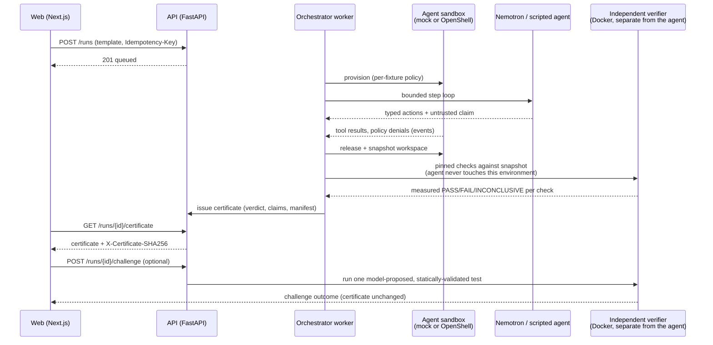

# ProofLayer — AI Agent Outcome Verification Studio
**Hackathon:** Nebius × NVIDIA Global AI Hackathon 2026  
**Team:** Dhyey (backend / security / infra lead) and Ancy (frontend / experience / evaluation lead); both contribute across the stack.  
**Track:** Coding and Agentic Engineering.  
**Submission deadline:** October 30, 2026, 10:00 AM MST (Arizona); submit earlier.  
**Implementation sprint:** October 19–25, 2026 (seven days); October 26–29 for polish, deployment, benchmarking and recording.

## Mission
An AI coding agent may claim a task succeeded even though tests fail, a forbidden action was attempted, or compatibility was never checked. ProofLayer collects enforcement evidence and *independently* evaluates explicit postconditions. Its report distinguishes VERIFIED, FAILED, and INCONCLUSIVE claims. It is **not** formal proof of software correctness and does not guarantee containment when actions bypass instrumented controls.

## The product in one sentence
A developer launches a bounded AI coding task, watches its actions in a real sandbox, challenges its completion claim with independently executed tests, and obtains an integrity-linked evidence certificate.

## Golden path demo
1. Open a hosted dashboard, choose the **False Success** fixture, review allowed paths and required checks.
2. Agent modifies sample Python application and says its selected tests passed.
3. Independent verifier runs the *full pinned suite*, finds an expired-token regression and reports FAILED.
4. Nemotron proposes a targeted additional test; a deterministic verifier validates and executes it (never arbitrary LLM shell text directly).
5. Evidence view shows command hashes, exit status, artifact hashes, claim mapping and a certificate JSON export.
6. Also demonstrate a policy-denied attempt to read `.env.production` via OpenShell, and a positive verification case.

## How a run becomes a certificate



The agent's claim and the verifier's measurement are produced by two
different components that never share an environment — the certificate
compares them, it never takes the agent's word (`docs/02_ARCHITECTURE_SECURITY.md`
has the full trust-boundary breakdown).

## Non-negotiable acceptance
- Every status has a server-side evidence source, never a fabricated UI value.
- One real end-to-end execution path with Nemotron on Nebius Token Factory.
- At least three pre-seeded cases (pass, false success, access denied), replayable locally.
- Failed action and failed task are distinct; attempted policy violation != successful secret read.
- Sandbox verifier is separated from the untrusted agent workspace; no agent access to verifier credentials or audit store.
- README, open-source license at repository root, public repo, live demo URL, <=3min YouTube video, and tool feedback ready.

## Quickstart (backend, mock mode, no cloud keys)
> **Security warning.** This is a hackathon prototype. By default (`SANDBOX_DRIVER=mock`,
> mock mode) the *agent* side uses deterministic test doubles: **no agent sandbox is
> enforced, the agent's own checks are simulated and no Nebius call is made**; every event
> says so (`enforced: false`, `simulated: true`, provider `scripted`) and
> `/api/v1/capabilities` reports `sandbox_enforced: false`. The independent verifier
> does execute the pinned tests, in a network-less Docker container (container isolation,
> not OpenShell); without Docker it reports every executed check INCONCLUSIVE. Never put real credentials in fixtures, never commit `.env`,
> and do not expose the API publicly before write operations are authenticated.

Requires Python 3.12+ and `make`.

```bash
git clone https://github.com/Dhyey0201/Prooflayer.git && cd Prooflayer
make install                  # .venv + pinned deps from apps/api/requirements-dev.txt
make lint test check-docs     # ruff check, ruff format --check, pytest -q, handoff check
make verifier-image           # independent verifier image (needs Docker; else INCONCLUSIVE)
make seed                     # optional: one queued fixture run per template
make run                      # alembic upgrade head, then API on http://127.0.0.1:8000
```

In another terminal:

```bash
curl -s http://127.0.0.1:8000/api/v1/health         # {"status":"ok"}
curl -s http://127.0.0.1:8000/api/v1/capabilities   # boolean flags only
curl -s http://127.0.0.1:8000/api/v1/templates      # trusted fixture registry
curl -s -X POST http://127.0.0.1:8000/api/v1/runs \
  -H 'Content-Type: application/json' -H 'Idempotency-Key: demo-run-0001' \
  -d '{"template_id":"false-success-auth","mode":"fixture"}'
curl -s http://127.0.0.1:8000/api/v1/runs/<id>/events   # hash-chained evidence events
curl -s http://127.0.0.1:8000/api/v1/runs/<id>/checks        # independent check results
curl -s http://127.0.0.1:8000/api/v1/runs/<id>/certificate   # evidence certificate
curl -s -X POST http://127.0.0.1:8000/api/v1/runs/<id>/challenge   # proof challenge
make verify-certificate RUN=<id>   # offline check against events + detached ledger
```

Seeded benchmark (needs Docker and `make verifier-image`):

```bash
make benchmark        # 18 seeded cases x 3 passes -> benchmarks/results/benchmark-report.json
make secret-scan      # credential patterns + exported secret values, tracked files and history
```

Each case is a real run through the orchestrator, the network-less verifier and the
certificate path, driven by a fixed model script with ground truth fixed in
`benchmarks/benchmark_manifest.json`; the CLI exits non-zero unless every case meets it,
the passes agree and no secret appears in any stored evidence. Results, metric
definitions and what they do **not** show: `docs/07_BENCHMARK_LIMITATIONS.md`.

A new run is queued and the background worker executes it: provision a sandbox,
run the bounded agent (scripted in `fixture` mode, Nemotron in `live` mode), snapshot
its workspace, release the sandbox, record the agent's claim. Then the **independent
verifier** grades it: each `required_check` maps to a pinned template
(`verifier/checks.py`). The full pytest suite runs in a fresh container (`--network none`,
read-only root, all capabilities dropped, non-root UID 10002, no IPC namespace,
CPU/memory/PID/file-descriptor/file-size/time caps,
workspace streamed in on stdin, no host mounts) on a tree rebuilt from the
digest-pinned fixture baseline plus only the agent's allowed files; the allowlist diff and
forbidden-access attempts are measured from the snapshot and the recorded events. Any
FAIL gives `failed`; all PASS with a valid event chain gives `verified`; anything
unmeasured gives `inconclusive`. The agent's claim is only compared against the result
(`SUPPORTED` / `CONTRADICTED` / `UNVERIFIED`). The certificate's manifest digest is also
appended to a detached ledger (`PROOFLAYER_EVIDENCE_LEDGER`), so
`python -m prooflayer_api.evidence.verify_cli` can detect edits to events, check results
or even a full database rewrite. Nothing is signed: this is tamper evidence, not
non-repudiation. `mode: "live"` returns 422 unless a Nebius key is set, mock mode is off
**and** an OpenShell sandbox is reachable. The one exception is the opt-in development
fallback `PROOFLAYER_ALLOW_UNENFORCED_LIVE=true` (refused when `PROOFLAYER_ENV=production`):
Nemotron then drives the agent in the mock sandbox, every such run records
`enforced: false`, its certificate lists the mock sandbox as a limitation, and checks that
need enforcement (e.g. no forbidden-access attempts) stay INCONCLUSIVE.

A **proof challenge** (`POST /runs/{id}/challenge`, certified runs only) asks the model
(scripted in fixture mode, Nemotron in live mode) for one pytest test matching
`contracts/schemas.json`. It is statically validated (AST: import allowlist, no
eval/open/dunder/monkeypatch, declarative module level; *not* a security boundary) and
only then run by the verifier against the run's recorded workspace. Outcomes come from
the exit code; rejected proposals are stored for review but never executed, and a
challenge never changes the certificate.

### Real sandbox and live model (opt-in)

```bash
# NVIDIA OpenShell CLI + gateway (macOS: Docker Desktop), see docs.nvidia.com/openshell
make sandbox-image            # one workspace image per fixture (needs Docker)
make policy FIXTURE=denied-secret-read   # print the generated OpenShell policy + sha256
SANDBOX_DRIVER=openshell make run
RUN_LIVE_INTEGRATION=1 NEBIUS_API_KEY=... make live-smoke   # real Nemotron + OpenShell checks
```

The OpenShell driver counts a sandbox as enforced only after its log shows the
Landlock ruleset applied; otherwise the run ends in `error`, never "secure".

**Live Nemotron evidence:** three live runs and their proof challenges (real
`nvidia/nemotron-3-super-120b-a12b` on Nebius, real Docker verifier, mock agent sandbox)
are exported in `benchmarks/live/` with their ledger entries, so anyone can re-check them
offline:

```bash
cd apps/api && ../../.venv/bin/python -m prooflayer_api.evidence.verify_cli \
  --certificate ../../benchmarks/live/success-validation.certificate.json \
  --events ../../benchmarks/live/success-validation.events.json \
  --ledger ../../benchmarks/live/evidence-ledger.jsonl
```

Results and the OpenShell blocker (Docker Desktop's kernel has no Landlock) are in
`docs/07_BENCHMARK_LIMITATIONS.md`.

Optional configuration: `cp .env.example .env` (git-ignored). Setting
`PROOFLAYER_MOCK_MODE=false` requires `NEBIUS_API_KEY`; the API refuses to start otherwise.
Keys are server-side only and are never returned by any endpoint.

**Hosted demo:** https://prooflayer-two.vercel.app, a read-only replay of the recorded runs (`PROOFLAYER_READ_ONLY=true`;
every write is a typed 403, and no agent or model runs). Build, lock-down and deploy
steps are in `docs/08_HOSTED_DEMO.md`.

Docker alternative: `docker compose up --build` (API on `127.0.0.1:8000`, or set
`API_PORT=8001`; non-root, read-only filesystem, SQLite in a named volume).

## Quickstart (frontend)

Requires Node.js 20+. Run the backend first (above) so the dashboard's
"Backend status" panel has something to call.

```bash
cd apps/web
npm install
npm run dev      # http://localhost:3000; expects the API on :8000 by default
```

`NEXT_PUBLIC_API_BASE_URL` (see `apps/web/.env.example`) is the only
configuration the browser reads; it never sees a Nebius, OpenShell or Tavily
key. The scenario cards, runs list and run detail page are wired to the live
backend — no fixture/sample data ships in the frontend. A launched run is
actually executed by the backend worker and independently verified within a
few seconds. The run detail page has four tabs: **Event trace** (with a
one-shot highlight on rows that just arrived via polling — never a fake
animation), **Claim inspector** (the agent's claim next to a real
before/after comparison against what the verifier measured — SUPPORTED,
CONTRADICTED or UNVERIFIED, never conflated), **Certificate** (the real
`GET /runs/{id}/certificate` — verdict, checks, manifest, both evidence
hashes, JSON export; 404 "not ready" until verification finishes), and
**Challenges** (request one proof challenge once certified, watch the
untrusted proposed test and its measured outcome, compared against the
original certificate check). See `apps/web/README.md` for scripts (`lint`,
`typecheck`, `build`, `test`).

## Repository layout
| Path | Purpose |
|---|---|
| `apps/api` | FastAPI service (`prooflayer_api`), Alembic migrations, Dockerfile |
| `apps/api/prooflayer_api/{ai,agent,sandbox}` | Nemotron adapter, bounded agent loop, OpenShell + mock sandbox drivers |
| `apps/api/prooflayer_api/fixture_workspaces` | Synthetic repos the agent edits (no real secrets) |
| `apps/api/prooflayer_api/verifier` | Independent verifier: pinned checks, Docker driver, certificate, challenge validation |
| `infra/sandbox` | OpenShell agent workspace image |
| `infra/verifier` | Independent verifier image and its trusted entrypoint |
| `apps/web` | Next.js (App Router) + TypeScript + Tailwind dashboard |
| `packages/contracts` | Python loaders for the canonical contracts |
| `contracts/` | `openapi.yaml`, `schemas.json` (source of truth) |
| `tests/` | pytest suite (API, config, contracts, migrations, repo hygiene) |
| `docs/` | PRD, architecture, plan, evaluation, deployment, demo, progress log |

## Read these files in order
1. `docs/01_PRODUCT_PRD.md` — goals, UX, stories and success criteria.
2. `docs/02_ARCHITECTURE_SECURITY.md` — data flow and trust model.
3. `docs/03_SEVEN_DAY_COMMIT_PLAN.md` — exact ownership and alternating integration protocol.
4. `docs/04_TEST_EVALUATION.md` — benchmark and acceptance; measured results in `docs/07_BENCHMARK_LIMITATIONS.md`.
5. `docs/05_SETUP_COST_DEPLOYMENT.md` — setup, cost limits, deployment.
6. `docs/06_DEMO_SUBMISSION.md` — judged demo, copy and final checklist.
7. `contracts/openapi.yaml`, `contracts/schemas.json` — contract-first interfaces.
8. `docs/PROGRESS_LOG.md` — per-commit evidence and handoff notes.

## Honest known limitations
- OpenShell enforcement is separate infrastructure from ProofLayer; our added value is independently checking the task outcome, not the sandbox implementation itself.
- **No run so far has had an enforced agent sandbox.** OpenShell 0.1.5 was installed and its gateway ran on the reference Mac, but every sandbox refused to start because Docker Desktop's Linux kernel lacks Landlock (`kernel lacks CONFIG_SECURITY_LANDLOCK`). The live Nemotron runs therefore used the mock sandbox, say so in their evidence, and need a Linux host with Landlock for real enforcement.
- Tests cannot prove the absence of every bug — a PASS means the pinned checks passed in the recorded verifier image, not broad correctness or compatibility.
- The hash chain and manifest are tamper **evidence**, not tamper **prevention**: they detect an altered log or a rewritten database, but nothing is signed, so this is not non-repudiable against someone who controls both the live database and the detached ledger.
- The independent verifier must be independently provisioned (a working Docker daemon, or OpenShell for the agent side) — without it, every executed check reports INCONCLUSIVE rather than a fabricated result.
- Model-generated proof-challenge tests are useful but still require a secure runner (never executed outside the verifier) and a clear, narrow definition of what they're checking; static AST validation rejects obviously dangerous code but is explicitly documented as *not* a security boundary on its own — the verifier's container isolation is.
- The benchmark measures the verification layer against 18 synthetic, scripted cases (not a live model, and with the mock agent sandbox); its numbers are exact for that set only. One seeded violation (code-level network exfiltration) is contained by the verifier but not flagged by any evidence signal. See `docs/07_BENCHMARK_LIMITATIONS.md` before citing a number.

## Principle: one trunk, one active writer
The initial seven-day plan alternates commits: Dhyey pushes, Ancy pulls and extends, Ancy pushes, Dhyey pulls and extends. For simplicity, use a protected `main` with a single active feature branch at a time and review PRs. **Never both modify the same local unpushed branch simultaneously.** No force-push, no committing credentials.

## Official references
- https://nebius.com/services/token-factory/nemotron
- https://api.tokenfactory.nebius.com/docs
- https://docs.nvidia.com/openshell/latest/get-started/quickstart
- https://docs.nvidia.com/openshell/latest/home
- https://github.com/NVIDIA/OpenShell
